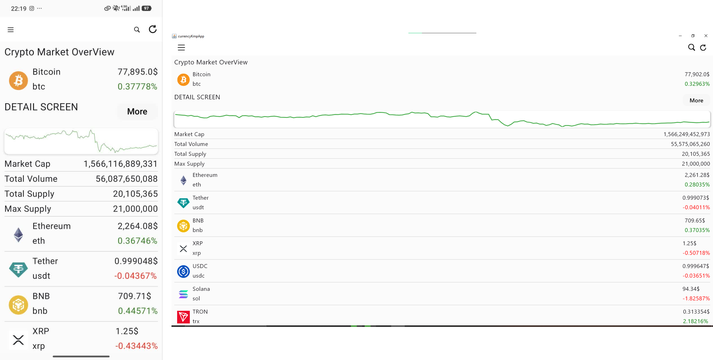

# Crypto Market Overview

A cross-platform cryptocurrency market dashboard built with **Kotlin Multiplatform** and **Compose Multiplatform**. It retrieves market data from the [CoinGecko API](https://api.coingecko.com/api/v3/coins/markets) and presents cryptocurrency prices, daily changes, market statistics, and price trends across Android, iOS, and Desktop.

<p align="center">
  
</p>

## Features

- Browse cryptocurrencies with their names, symbols, prices, and 24-hour price changes.
- View a selected coin's market cap, trading volume, supply information, and 7-day price trend.
- Search for cryptocurrencies and refresh market data.
- Shared Compose UI and common data/networking logic across supported platforms.
- Loading and error states for network requests.

## Tech Stack

| Area | Technologies |
|---|---|
| Language & UI | Kotlin 2.2, Kotlin Multiplatform, Compose Multiplatform 1.8, Material 3 |
| Networking | Ktor Client 3.2, OkHttp (Android/Desktop), Darwin (iOS) |
| API & serialization | CoinGecko REST API, kotlinx.serialization |
| Dependency injection | Koin |
| State & concurrency | AndroidX Lifecycle ViewModel, Kotlin Coroutines |
| Build | Gradle 8.13, Android Gradle Plugin 8.11 |

The shared data flow is organized around `MainViewModel` and `ApiRepository`:

```text
Compose UI  →  MainViewModel  →  ApiRepository  →  CoinGecko API
```

> **Search implementation note:** The current `getCurrency(query)` method sends `ids` to CoinGecko's `/search` endpoint and expects a market-data list. CoinGecko documents `/search` with a `query` parameter and a different response structure; `ids` filtering belongs to `/coins/markets`. The search request/model mapping should be corrected before relying on remote search.

## Supported Platforms

- **Android** — minimum SDK 24
- **iOS** — device and simulator targets; requires macOS and Xcode
- **Desktop** — JVM application for Windows, macOS, and Linux

## Getting Started

### Requirements

- JDK 17 or newer
- Android Studio with Kotlin Multiplatform support
- Android SDK (for Android builds)
- macOS and Xcode (only for iOS builds)
- Internet connection to retrieve market data from CoinGecko

### Clone the repository

```bash
git clone https://github.com/montatech/currency_kmp_App.git
cd currency_kmp_App
```

### Run the app

**Android** — connect a device or start an emulator, then run:

```bash
./gradlew :composeApp:installDebug
```

**Desktop** — launch the JVM application:

```bash
./gradlew :composeApp:run
```

**iOS** — open the iOS project in the `iosApp` directory with Xcode, select a simulator or device, and run the app. iOS builds require macOS.

To create a native desktop package for the current operating system:

```bash
./gradlew :composeApp:packageDistributionForCurrentOS
```

## Project Structure

```text
.
├── composeApp/
│   ├── src/
│   │   ├── commonMain/   # Shared Compose UI, ViewModel, models, and API repository
│   │   ├── androidMain/  # Android entry point and Android-specific code
│   │   ├── nativeMain/   # Native networking implementation (iOS)
│   │   └── desktopMain/  # Desktop-specific code
│   └── build.gradle.kts
├── iosApp/               # iOS application entry point
├── gradle/               # Gradle wrapper and version catalog
├── build.gradle.kts
├── settings.gradle.kts
└── gradlew
```

---

**Note:** Market prices and statistics are retrieved from CoinGecko and may change over time or be subject to the API provider's rate limits.
